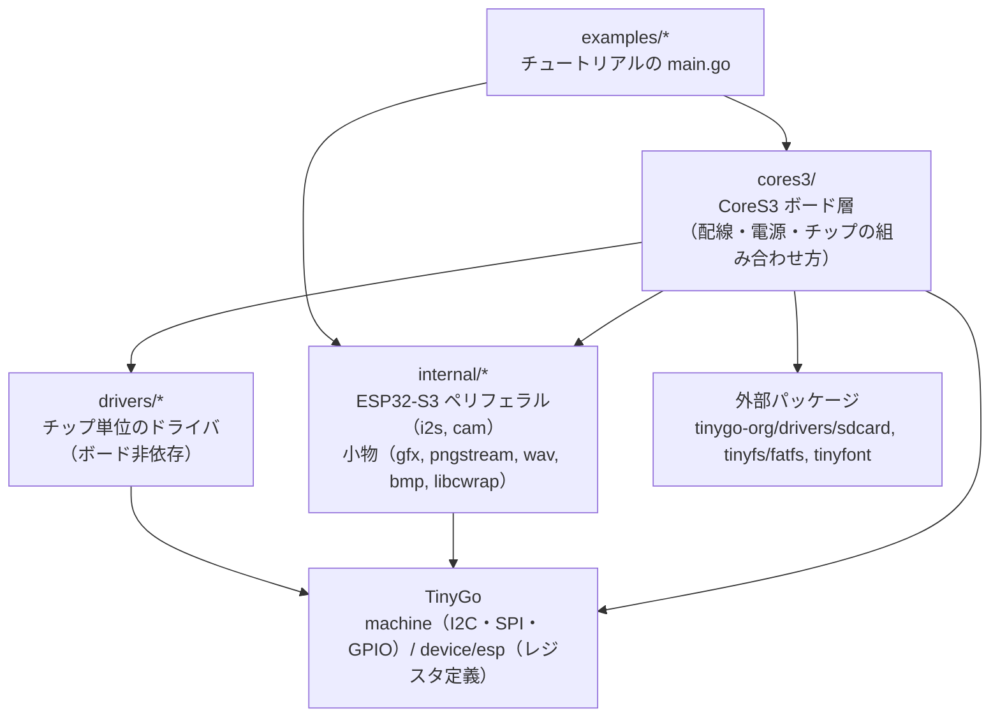
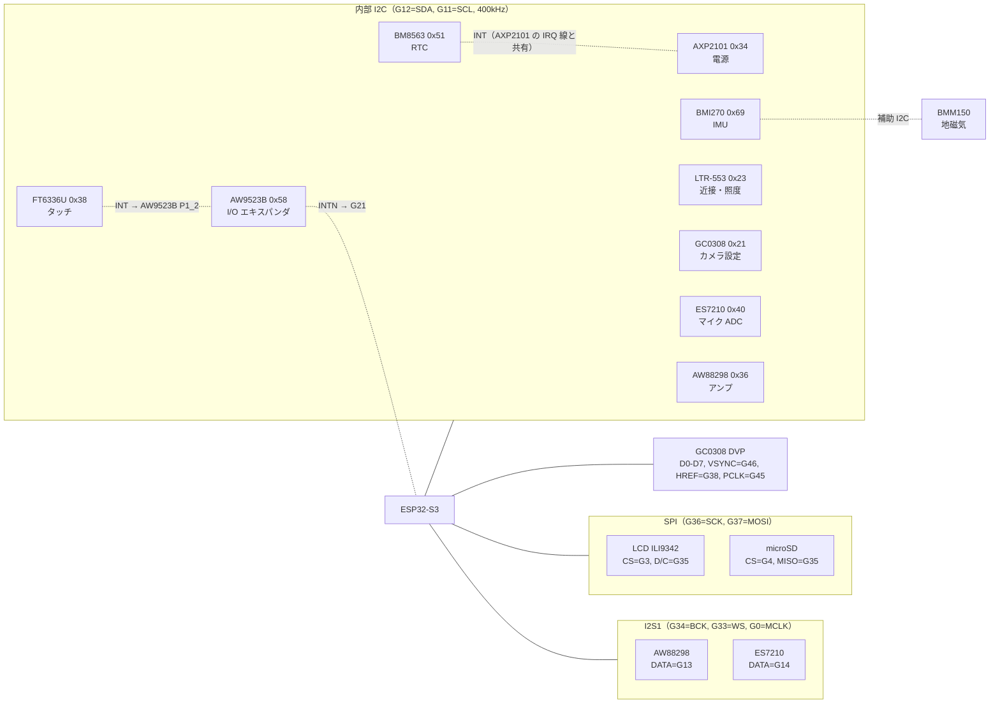
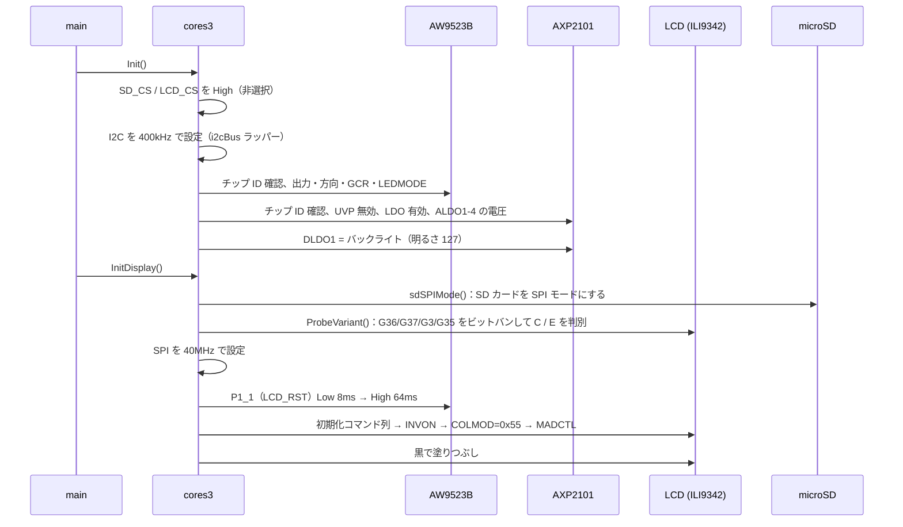
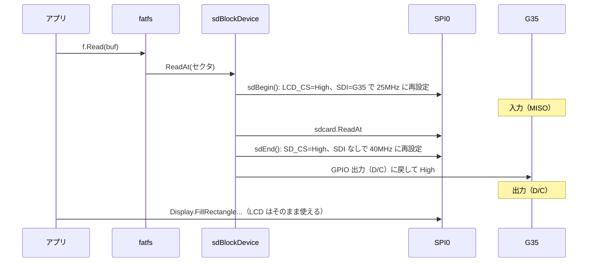
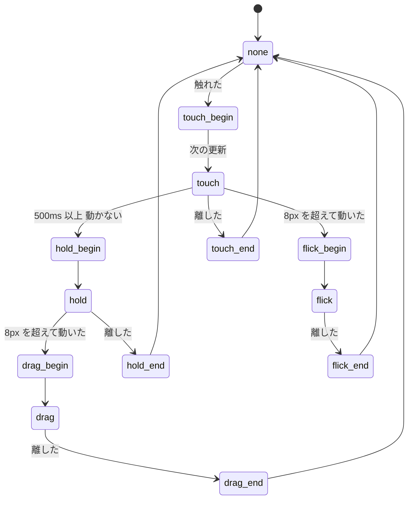
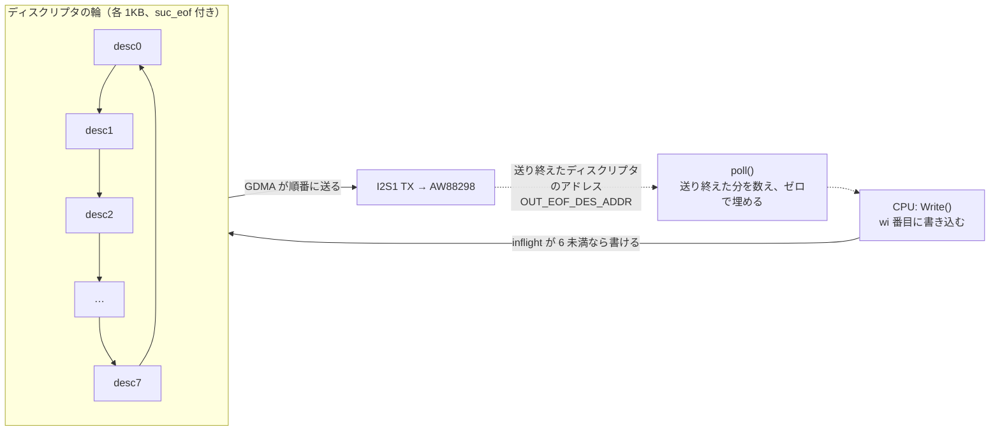
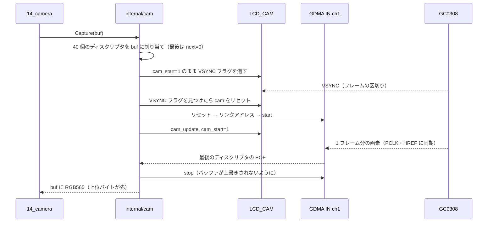
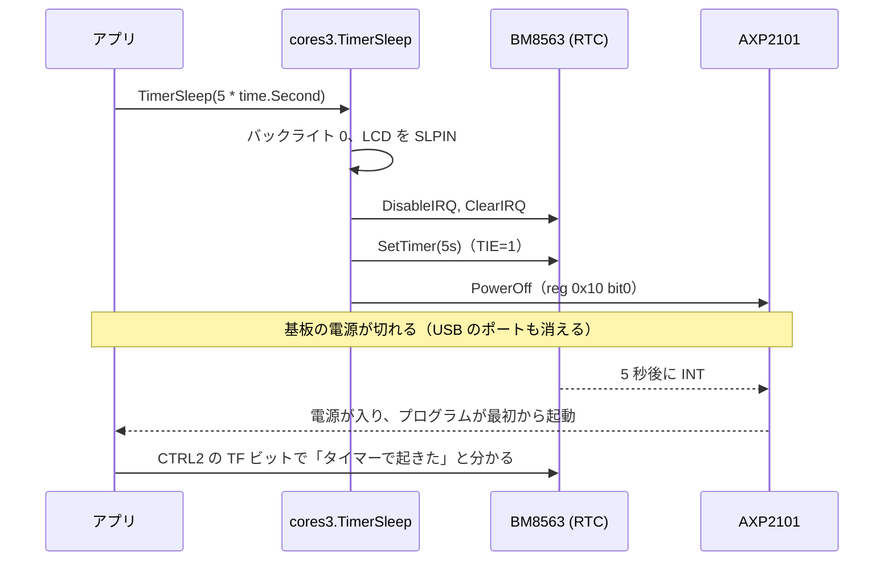

# コード解説（アーキテクチャと読み方ガイド）

このリポジトリを自分で保守できるようになるための解説です。
細かい調査の経緯やハマりどころは [notes.md](notes.md) に、使い方は [README](../README.md) にあります。

図は Mermaid で書いています。GitHub や VS Code の Markdown プレビュー（Mermaid 対応の拡張が必要な場合あり）で図として表示されます。

---

## 1. 全体の構造

### 1.1 4 つの層



| 層 | 置くもの | 置かないもの |
|---|---|---|
| `drivers/` | 1 つのチップのレジスタと操作（例: AXP2101 の DLDO1 の電圧を設定する） | ピン番号、どの電源が何につながっているか |
| `cores3/` | CoreS3 の配線と手順（例: DLDO1 は LCD バックライト、LCD のリセットは AW9523B の P1_1） | チップのレジスタの詳細 |
| `internal/` | ESP32-S3 のペリフェラルのうち TinyGo にないもの（I2S、カメラ）と、汎用の小物 | ボードの事情 |
| `examples/` | チュートリアルの動作そのもの | ハードウェアの操作 |

この分け方は CLAUDE.md の作業ルール 4・5 に従っています。`drivers/` は将来 tinygo-org/drivers に PR を出せる形
（`New(bus) Device` → `Configure()` → 読み書きメソッド）にそろえています。

### 1.2 パッケージ一覧

| パッケージ | 行数の目安 | 役割 |
|---|---|---|
| `cores3` | 1,600 | ボード層。すべてのサンプルが使う |
| `drivers/axp2101` | 320 | 電源管理 IC。LDO、充電、電池・VBUS、電源ボタンの IRQ、電源オフ |
| `drivers/aw9523b` | 130 | I/O エキスパンダ。各チップのリセット線、5V 出力の制御 |
| `drivers/ili9342` | 530 | LCD。ILI9342C / E の初期化列と、C/E の判別（ビットバン） |
| `drivers/bm8563` | 210 | RTC。日時と、電源オフからの復帰に使うタイマー |
| `drivers/ltr553` | 220 | 近接・照度センサ |
| `drivers/bmi270` | 280 | IMU。8KB の設定ファイルの書き込み、補助 I2C（地磁気センサ BMM150） |
| `drivers/aw88298` | 80 | スピーカーアンプ |
| `drivers/es7210` | 100 | マイク用 ADC |
| `drivers/gc0308` | 160 | カメラ |
| `internal/i2s` | 530 | I2S1 + GDMA（送信・受信） |
| `internal/cam` | 210 | LCD_CAM + GDMA（カメラ 1 フレームの取り込み） |
| `internal/gfx` | 250 | 円・三角形・文字の描画（`FillRectangle565` だけで描く） |
| `internal/pngstream` | 310 | PNG を 1 行ずつ展開する |
| `internal/wav` | 90 | WAV のヘッダ解析 |
| `internal/bmp` | 60 | BMP の書き出し |
| `internal/libcwrap` | 10 | C の malloc を TinyGo の runtime につなぐ |

### 1.3 規約

- **出典を書く**: レジスタ値や手順には `// ref: M5Unified ...` のように出典を書く。推測の値には `TODO(verify)` を付ける。
- **ループ内でヒープを確保しない**: バッファは構造体や global に持って使い回す。文字列は `gfx.Itoa` などで `[]byte` に組み立て、
  `gfx.String` でコピーせずに文字列として渡す。`fmt` は使わない。
- **ログは `println`**: `cores3.Verbose` が true のときは、初期化で書いたレジスタ値をすべてシリアルに出す。サンプルは初期化後に false にしている。

---

## 2. ハードウェアの接続



覚えておくべき配線の特徴は 4 つです。

1. **ほぼ全部のチップが 1 本の内部 I2C にぶら下がっている**。I2C の調子が悪いと、すべてが動かなくなる。
2. **G35 が LCD の D/C と microSD の MISO を兼ねている**（[5 章](#5-lcd-と-microsd-の-spi-共有)）。
3. **リセット線や割り込み線の多くは AW9523B 経由**。たとえば LCD のリセットは AW9523B の P1_1、タッチの INT は AW9523B の P1_2 → AW9523B の INTN → G21。
4. **スピーカーとマイクは BCK・WS を共有している**。同時には使えず、I2S1 の送信と受信を切り替えて使う。

ピンと I2C アドレスは [cores3/pins.go](../cores3/pins.go) にまとまっています。

---

## 3. 起動の流れ

どのサンプルも次の形で始まります。

```go
cores3.Init()        // 必須。I2C を開き、電源と I/O エキスパンダを設定する
cores3.InitDisplay() // 画面を使うなら
cores3.InitTouch()   // 以下は必要なものだけ: InitSD, InitRTC, InitIMU, StartSpeaker, StartMic, InitCamera
```



### 3.1 cores3.Init（[init.go](../cores3/init.go)）

`steps` という表に、AW9523B と AXP2101 に書く値が順番に並んでいます。前半は M5GFX の autodetect、後半は M5Unified の `Power_Class::begin` と同じ値です。
`Verbose` が true なら、書いた値と読み戻した値を 1 行ずつ出します。電源まわりを変えたときは、このログで確認できます。

### 3.2 I2C のラッパー（[i2c.go](../cores3/i2c.go)）

`cores3.I2C` は `machine.I2C0` そのものではなく、`i2cBus` というラッパーです。TinyGo 0.42 の ESP32-S3 用 I2C に問題が 2 つあり、それを回避しています。

| 問題 | 症状 | 回避策 |
|---|---|---|
| 読み出しを含む `Tx` が、STOP の送出完了前に戻る | すぐ次の通信をすると、前回の値がエラーなしで返る | 読み出しの後に TRANS_COMPLETE フラグを最大 2ms 待つ |
| 一度 NACK を受けると、以降の通信がすべて失敗する | 以降すべて "expected ACK not NACK" | エラーのたびに `Configure` し直す |

**新しく I2C のチップを足すときは、必ず `cores3.I2C` を渡してください。** `machine.I2C0` を直接使うと上の問題が再発します。

---

## 4. LCD

### 4.1 ILI9342C と ILI9342E

CoreS3 の LCD は、出荷時期によって ILI9342C と ILI9342E のどちらかです。初期化コマンド列が違い、C の列を E に送ってはいけません。
[drivers/ili9342/probe.go](../drivers/ili9342/probe.go) の `ProbeVariant` が、M5GFX と同じ手順（D9h 経由で DDh・CBh を読み戻す）で判別します。

TinyGo の SPI は「MOSI 線で読む」（3 線式の読み出し）ができないので、**判別のときだけ 4 本のピンを GPIO にしてビットバン**しています。
判別後に `SPI.Configure` でピンを SPI に戻します。手元の個体は C でした。E での判別は未確認です。

### 4.2 回転

M5GFX では CoreS3 のパネルに `offset_rotation = 3` があり、ユーザーが指定する回転 `r` はコントローラの回転 `(r + 3) & 3` に変換されます
（[display.go](../cores3/display.go) の `controllerRotation`）。既定のユーザー回転 1 は、コントローラ回転 0（横長 320×240、MADCTL = 0x08）になります。
タッチ座標の変換（[touch.go](../cores3/touch.go) の `convertRawXY`）も、このコントローラ回転を見ます。

### 4.3 描画の速さ

TinyGo の SPI は DMA を使わず、64 バイトずつポーリングで送ります。1 ピクセルずつ `SetPixel` すると、そのたびに描画範囲の設定コマンドが送られて遅くなります。
そのため `internal/gfx` は、図形も文字も「横 1 行分の塗りつぶし（`FillRectangle565`）」の組み合わせで描いています。

---

## 5. LCD と microSD の SPI 共有

### 5.1 G35 の役割の切り替え

G35 は、LCD にとっては D/C（出力）、SD カードにとっては MISO（入力）です。M5GFX は LCD の CS を切り替えるたびに G35 の役割を変えています。
このリポジトリでは、**SD のブロックアクセスのたびに** [sd.go](../cores3/sd.go) の `sdBegin` / `sdEnd` で切り替えます。LCD 側のドライバには手を入れていません。



### 5.2 SD カードを SPI モードにしておく

電源投入直後の SD カードは「SD モード」で待っていて、共有線上の LCD 向けの通信を自分宛てのコマンドと解釈することがあります。
固まると電源を切るまで戻りません。そこで `InitDisplay` の最初に `sdSPIMode()`（M5GFX の `_set_sd_spimode` の移植）を呼び、
LCD を触る前にカードを SPI モードにしています。SPI モードのカードは、CS が High の間は通信を無視します。

それでも固まることがあったため、`InitSD` は失敗すると **RTC タイマーで 2 秒後に起動する設定にして基板の電源を 1 回だけ入れ直します**
（`SDPowerCycle`）。RTC の TF フラグで「自分のタイマーで起きた直後」かを見分け、2 回目は諦めてエラーを返します。

### 5.3 FAT と C コード

FAT は tinyfs の `fatfs`（C の FatFs を cgo で組み込んだもの）です。esp32s3 ターゲットは `--wrap=malloc` でリンクするので、
C の `malloc` は `__wrap_malloc` に置き換わります。その実体は通常は無線用パッケージが持っています。
無線を使わないこのリポジトリでは、[internal/libcwrap](../internal/libcwrap) が `__wrap_malloc` → `__real_malloc`（TinyGo の runtime）に転送しています。

---

## 6. タッチと電源ボタン

### 6.1 タッチの読み出し（[touch.go](../cores3/touch.go)）

1. G21（AW9523B の INTN）が **Low のときだけ** FT6336U を読む。
2. 0 点だったら、AW9523B の入力ポート（0x00, 0x01）を読んで割り込みを解除する。
3. 読み出し中に値が変わることがあるので、2 回同じ値が読めるまで読み直す（最大 5 回）。

### 6.2 状態遷移（M5Unified の Touch_Class の移植）

状態は 4 ビットで表します。bit0 = 触れている、bit1 = 変化した直後、bit2 = 長押し、bit3 = 動いた。



- **flick と drag の違い**: 長押し（hold）になる前に動けば flick、hold になった後に動けば drag。
- `TouchDetail.X/Y` は、flick・drag 中だけ更新されます。それ以外は触れ始めた位置のままです。
- 閾値は `Touch.FlickThresh`（8px）と `Touch.HoldMsec`（500ms）。`Update` は 4ms より短い間隔で呼ばれると、時間経過の判定だけを行います。

### 6.3 電源ボタン（[button.go](../cores3/button.go)）

電源ボタンは AXP2101 の PWRON ピンにだけつながっていて、ESP32 からは押されている状態を直接読めません。
AXP2101 の IRQ ステータス（0x49）の「短押し」「長押し」ビットを 4ms ごとに読み、1 を書いて消します。
そのため取れるのは **クリック（WasClicked）と長押し（WasHold）だけ**です。約 4 秒押し続けると、AXP2101 が電源を切ります（0x27 = 0x00 の設定）。

---

## 7. 音声（I2S + GDMA）

### 7.1 なぜ自作か

TinyGo には ESP32 系の I2S がありません。さらに ESP32-S3 の I2S には、CPU からデータを書き込むレジスタがなく、**DMA（GDMA）でしかデータを出し入れできません**。
[internal/i2s](../internal/i2s) は ESP-IDF の低レベルドライバ（i2s_ll.h、gdma_ll.h）を一次資料にして、レジスタを直接操作しています。

| 方向 | 使うもの | ディスクリプタ |
|---|---|---|
| 送信（スピーカー） | I2S1 TX + GDMA OUT ch0 | 1KB × 8 を輪にする |
| 受信（マイク） | I2S1 RX + GDMA IN ch0 | 1KB × 8 を輪にする |
| （カメラ） | LCD_CAM + GDMA IN ch1 | 3840 バイト × 40 を一直線に |

### 7.2 送信リングの仕組み



- GDMA は輪を回り続けます。CPU は `OUT_EOF_DES_ADDR` を**ポーリング**して、どこまで送り終えたかを知ります（割り込みは使っていません）。
- **送り終えたバッファはゼロで埋めます**。CPU の書き込みが間に合わなくても、古い音を繰り返さずに無音になります。
- `Write` は空きがなければ 1ms ずつ待ちます。`Flush` は書いた分がすべて送られるまで待ちます。

### 7.3 スピーカーは常に 48kHz・モノラル

実測で、CoreS3 のアンプ AW88298 は **左スロットしか鳴らさず、44.1kHz では鳴りません**でした。
M5Unified と同じく、スピーカーは常に 48kHz・モノラルで動かし、データ側を変換します（[speaker.go](../cores3/speaker.go) の `QueuePCMResampled`、線形補間）。


### 7.4 マイク

マイクは I2S1 の受信側です。M5Unified に合わせて 240MHz の PLL から MCLK（256fs）を作り、G0 に出します。
ES7210 は MCLK が出てから設定します。受信データは [mic.go](../cores3/mic.go) の `ReadMic` で、M5Unified と同じ処理
（自動で DC 成分を除く、ノイズフィルタ、左右の平均）をしてから返します。

スピーカーとマイクはピンを共有しているので、**切り替えるときは必ず片方を止めてから**もう片方を始めます（12_mic の再生処理を参照）。

---

## 8. カメラ（LCD_CAM + GDMA）

[internal/cam](../internal/cam/cam.go) は 1 フレームだけを取り込みます。PSRAM が使えないので、フレームバッファ（320×240×2 = 153,600 バイト）は内部 RAM に 1 枚だけです。



ハマりどころが 2 つありました（[notes.md](notes.md) にも記録）。

- **VSYNC のフラグは、カメラ部が動いている（cam_start=1）間しか立たない**。
- **GDMA のリセットは起動直後に有効なまま**。I2S を使うプログラムでは I2S 側の初期化で解除されていたので気付きませんでした。カメラ単体では、自分で解除しないと DMA が動きません。

画素は「上位バイトが先」の RGB565 で、LCD にそのまま送れます。BMP に保存するときは [internal/bmp](../internal/bmp/bmp.go) で 24bit BGR・下の行から順に変換します。

---

## 9. 電源オフからの復帰（Wakeup）

CoreS3 の RTC の INT は ESP32 につながっていません（AXP2101 の IRQ 線と共有）。そのため ESP32 のディープスリープではなく、
**「RTC のタイマーをセットして、AXP2101 で基板ごと電源を切る」→「時間が来たら RTC の INT で電源が入る」**という方法です。



この仕組みは `InitSD` の自動回復（5.2）や `tools/sdput` でも使っています。

---

## 10. 保守の手引き

### 10.1 よくある変更と触る場所

| やりたいこと | 触る場所 |
|---|---|
| 内部 I2C に新しいセンサーを足す | `drivers/<chip>` を作り、`New(cores3.I2C)` で使う |
| Grove PORT.A の I2C センサーを使う | 別の I2C（`machine.I2C1`）を G2/G1 で設定する（pins.go の `PORTA_*`）。内部 I2C と同じ回避策が必要なら `i2cBus` と同じ方法で包む |
| LCD の向きを変える | `cores3.SetRotation(r)`。タッチ座標も `convertRawXY` で自動で追従する |
| LCD の SPI 速度を変える | `cores3.LCDFrequency`（SD アクセス後の `sdEnd` もこの値に戻す） |
| 起動時のレジスタログを止める | `cores3.Verbose = false` |
| SD の自動電源入れ直しを止める | `cores3.SDPowerCycle = false` |
| 音量 | トーン: `cores3.ToneAmplitude`、WAV: 13_wav の `volume` |
| 写真の解像度を変える | `gc0308.setQVGA` の窓・サブサンプル設定、`cores3.PhotoWidth/Height`、`internal/cam` の `nodeSize`（1 ライン分のバイト数の倍数にする） |

### 10.2 デバッグの基本

- **まずシリアルログ**。`tinygo monitor` を先に起動しておく（ESP32-S3 の USB シリアルは、PC が読んでいない間の出力を捨てる）。
- I2C のチップが応答しないときは、[00_i2c_scan](../examples/00_i2c_scan) で見えるか確認する。
- 電源まわりは [00_power_on](../examples/00_power_on) のレジスタダンプ（`cores3.DumpRegisters`）で確認する。
- 書き込めないときは、リセットボタンを約 3 秒長押しし、緑の LED が点いたら離す（ダウンロードモード）。
- SD が認識されないときは、自動の電源入れ直しのログ（`power-cycling the board`）が出ているか見る。

### 10.3 TinyGo を更新するときに確認すること

この実装には「TinyGo 0.42 の問題を回避するためのコード」が含まれています。TinyGo を更新したら、次の回避策がまだ必要かを確認してください。

| 回避策 | 場所 | 確認方法 |
|---|---|---|
| I2C の完了待ち・NACK 後の再設定 | cores3/i2c.go | 00_power_on のレジスタの読み戻しが一致するか（ラッパーを外して試す） |
| 文字列配列の添字アクセスを避けた書き方 | examples/07_imu の `screen3` | 元の書き方に戻して `out of memory` が出ないか |
| `__wrap_malloc` の転送 | internal/libcwrap | 外してリンクできるか |
| `ili9342` / `bm8563` の自作 | drivers | 上流の `ili9341` / `pcf8563` の修正状況 |
